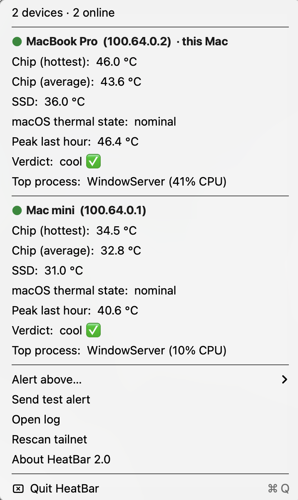

# HeatBar

HeatBar is a small menu-bar app that shows the chip temperature of every Mac on your Tailscale network.

Install it on each Mac. Each copy reads its own sensors, finds the other copies on the tailnet by itself, and shows them all in one menu. If one of your Macs runs hot, starts throttling, or stops answering, every other Mac gets a notification.



A ⚠︎ after the menu-bar temperature means another Mac is not cool.

## Requirements

- macOS 13 or later.
- Apple Silicon for temperature readings. Intel Macs can run HeatBar to watch other Macs, but show no readings of their own.
- [Tailscale](https://tailscale.com) on every Mac, signed in to the same tailnet. Without it HeatBar still shows the local Mac.

## Install

Download `HeatBar-2.0.zip`, unzip it, and run:

```bash
bash ~/Downloads/HeatBar-2.0/install.sh
```

This copies `HeatBar.app` to `~/Applications`, clears the download quarantine flag, and adds a launch agent named after the app's bundle ID so HeatBar starts at login. To remove it, run `uninstall.sh` from the same folder.

## How it works

**Sensors.** HeatBar reads the SoC die sensors through `IOHIDEventSystemClient`, every 5 seconds. This doesn't need root, but it is private API, so HeatBar can't be distributed through the Mac App Store.

**Serving.** Each copy answers HTTP on port 8765. It binds only to its Tailscale addresses (from `tailscale status --json`), so nothing on the LAN can read it. If Tailscale isn't found, it falls back to all interfaces and only answers localhost, Tailscale and private-LAN addresses.

| Path | Returns |
|---|---|
| `/` or `/status` | Current readings as JSON (below) |
| `/ping` | `{"v":2,"host":"…","uptime":123}` for checking with curl |

**Discovery.** At launch and every 60 seconds, HeatBar runs `tailscale status --json` and looks at every peer whose OS is macOS. It probes each one with a 2-second request to port 8765. Peers that answer with HeatBar status become devices. Peers that don't are probed again every 10 minutes. **Rescan tailnet** in the menu probes all of them right away. Devices are keyed by Tailscale node ID.

**Presence.** Tailscale is only used to find peers. Whether a device is online comes from HeatBar's own status requests, which run every 5 seconds:

| State | When | Shown as |
|---|---|---|
| online | the last request succeeded | normal stats, green dot |
| stale | 3 requests in a row failed | last stats greyed out, "No answer for N s" |
| offline | no answer for 2 minutes | "Offline — last seen N min ago", polled once a minute |

A device that disappears from the tailnet stays in the list for 24 hours.

**Alerts**, per device, each with a 10-minute cooldown:

- the chip stays at or above the threshold (default 90 °C, set under **Alert above…**) for 30 seconds;
- macOS reports the thermal state `serious` or `critical`;
- a device that was online goes 2 minutes without answering, and again when it comes back.

Every Mac alerts about every device, so with three Macs you get three notifications for one event.

## Security and privacy

- Anyone who can reach a Mac over your tailnet can read its HeatBar status, including the name of its busiest process. That includes machines shared into your tailnet by other people. Use Tailscale ACLs to restrict port 8765 if that matters to you.
- There is no authentication and no encryption beyond what Tailscale's WireGuard tunnel already provides. The status is read-only.
- Plain `http://` to other Macs needs an App Transport Security exception (`NSAllowsArbitraryLoads` in `Info.plist`). Without it macOS refuses the requests with error -1022.
- Builds without `SIGN_ID` are signed ad hoc, so Gatekeeper blocks them when opened from a download. `install.sh` removes the quarantine flag to get past this. Read the script before running it. Notarized release builds don't need that step.

## Status JSON

```json
{
  "v": 2,
  "host": "Studio Mac mini",
  "app_version": "2.0",
  "time": "2026-11-19T22:50:26+08:00",
  "chip_max": 34.4, "chip_avg": 32.8, "ssd": 31.0,
  "thermal_state": "nominal",
  "peak_1h": 42.8,
  "verdict": "cool",
  "top_process": {"name": "WindowServer", "cpu": 10.7}
}
```

The payload also carries the 1.x field names (`chipMax`, `chipAvg`, `thermalState`, `peakHour`, `topProcess`) so older copies can still read it. A payload without `v` is treated as version 1.

## Build

Needs the Xcode command-line tools (`xcode-select --install`).

```bash
./build.sh
```

This builds a universal (arm64 + x86_64) `build/HeatBar.app` and packages `dist/HeatBar-2.0.zip` with the app, the install scripts and this README. By default the app is signed ad hoc with the bundle ID `local.heatbar`.

For a release build, set these before running `build.sh`:

| Variable | Meaning |
|---|---|
| `BUNDLE_ID` | Bundle identifier, also used as the launch agent label |
| `SIGN_ID` | Code-signing identity, e.g. `Developer ID Application: Your Name (TEAMID)`. Signs with the hardened runtime. |
| `NOTARY_PROFILE` | A `notarytool` keychain profile. When set, the app is notarized and the ticket stapled. |

```bash
BUNDLE_ID=com.example.heatbar SIGN_ID="Developer ID Application: Your Name (TEAMID)" NOTARY_PROFILE=heatbar ./build.sh
```

### Testing two copies on one Mac

A second copy can listen on another port and treat its own Mac as a peer:

```bash
build/HeatBar.app/Contents/MacOS/HeatBar -port 8766 -debugSelfAsPeer YES
```

`-peerPort` changes the port HeatBar probes on other Macs (default 8765). `-threshold 40` overrides the alert threshold for that run, which is handy for testing alerts.

## Files

- Settings: `defaults read <bundle ID>` (`threshold`)
- Log: `~/Library/Logs/HeatBar.log`
- Launch agent: `~/Library/LaunchAgents/<bundle ID>.plist`

## License

MIT, see [LICENSE](LICENSE).
